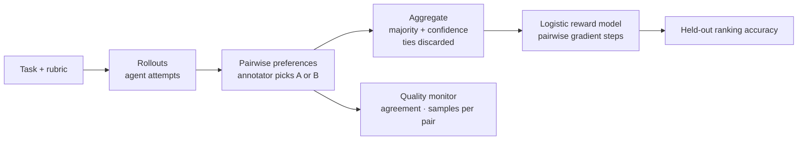

# RLHF Preference Data Platform

**The data pipeline behind RLHF-style training, end to end at small scale: collect pairwise human preferences on agent rollouts, aggregate them into confidence-weighted labels, measure annotator agreement, train a logistic reward model, and check it on held-out pairs.**

Reward models are only as good as the preference data behind them, and that data degrades quietly — annotators disagree, pairs go under-sampled, labels drift. This project models that pipeline in plain Python and NumPy so each step, and each quality check, is small enough to read in one sitting.



## What's implemented

- **Data model.** `Task` (prompt + rubric), `Rollout` (one agent response), and `Preference` (one annotator's A-vs-B judgment). Recording a preference whose winner isn't one of the two rollouts raises an error.
- **Label aggregation.** All judgments on an unordered pair are combined by majority vote, with `confidence` = the fraction that agreed. Ties are dropped because they carry no training signal.
- **Inter-annotator agreement.** Per-pair majority share (1.0 unanimous, 0.5 an even split) and a dataset-wide mean.
- **Quality monitor.** Flags `LOW_AGREEMENT` below 0.65 mean agreement and `UNDER_SAMPLED` below two judgments per pair.
- **Reward model.** A 4-feature linear scorer (length, digit density, sentence count, bias) trained with the pairwise logistic (Bradley–Terry) gradient so winners outscore losers. The features are deliberately toy; the training loop is the point.
- **Evaluation.** A train/held-out split and ranking accuracy: the fraction of held-out pairs where the model scores the human-preferred rollout higher.
- **API.** FastAPI endpoints to record preferences and report feedback quality for a task.

## Example

```python
from rlhf.store import Store
from rlhf.models import Rollout
from rlhf.preferences import PreferenceLog, Preference
from rlhf.aggregate import aggregate_pair
from rlhf.monitor import quality_report
from rlhf.reward import RewardModel
from rlhf.trainer import train_once

store, log = Store(), PreferenceLog()
store.add_rollout(Rollout("r1", "t1", "Paris.", "model-a"))
store.add_rollout(Rollout("r2", "t1", "The capital of France is Paris. It has 2.1 million residents.", "model-b"))

for annotator, winner in [("ann1", "r2"), ("ann2", "r2"), ("ann3", "r1")]:
    log.record(Preference("t1", "r1", "r2", annotator, winner))

aggregate_pair(log, "r1", "r2")
# {'winner': 'r2', 'loser': 'r1', 'confidence': 0.666…, 'n': 3}

quality_report(log, [("r1", "r2")])
# {'mean_agreement': 0.667, 'avg_prefs_per_pair': 3.0, 'flags': [], 'healthy': True}

model = RewardModel()
for _ in range(20):
    train_once(model, log, store, [("r1", "r2")])
model.score(store.rollouts["r2"].response) > model.score(store.rollouts["r1"].response)  # True
```

Outputs shown are from running this snippet.

## Quick start

Requires Python 3.10+.

```bash
git clone https://github.com/AliAzamat/ai-rl-training-platform.git
cd ai-rl-training-platform
pip install fastapi uvicorn numpy

uvicorn rlhf.server:app --reload
```

| Method | Path | Description |
|---|---|---|
| `POST` | `/v1/preferences` | Record `{task_id, rollout_a, rollout_b, annotator, winner}` |
| `GET` | `/v1/quality?task_id=` | Agreement, samples per pair, and health flags for the task's rollout pairs |
| `GET` | `/health` | Liveness |

## Layout

| Module | Purpose |
|---|---|
| `rlhf/models.py` | `Task` and `Rollout` |
| `rlhf/preferences.py` | `Preference` and `PreferenceLog` |
| `rlhf/aggregate.py` | Majority-vote labels with confidence |
| `rlhf/agreement.py` | Per-pair and mean annotator agreement |
| `rlhf/monitor.py` | Quality thresholds and health report |
| `rlhf/reward.py` | Features and logistic pairwise reward model |
| `rlhf/trainer.py` | Training pass over aggregated labels; polling loop |
| `rlhf/eval.py` | Held-out split and ranking accuracy |
| `rlhf/store.py` | In-memory task and rollout store |
| `rlhf/server.py` | FastAPI app |

## Limitations

- **No way to add tasks or rollouts over HTTP**, so `/v1/quality` reports an empty, unhealthy dataset when run standalone; populate the store in code.
- **All state is in memory and per process.** The `trainer` service in `docker-compose.yml` can't see preferences recorded by the `api` service, Redis is provisioned but unused, and `rlhf.trainer` has no `__main__` entry point.
- **No `Dockerfile`, dependency file, or tests** yet, so `docker compose up` won't build.
- Reward features are hand-picked toy signals, not embeddings.
